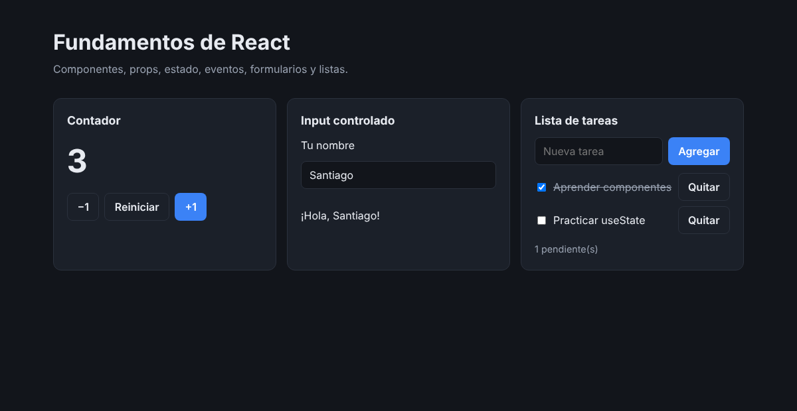

# Fundamentos de React

Práctica del curso de React: una página con tres ejercicios pequeños que cubren los conceptos base de la librería.




## Qué practica

| Ejercicio | Conceptos |
|---|---|
| **Contador** | `useState`, eventos `onClick`, renderizado condicional |
| **Input controlado** | Formularios controlados, `onChange`, plantillas de texto |
| **Lista de tareas** | Listas con `map` y `key`, `onSubmit`, actualizar arrays y objetos sin mutarlos |
| **MiBoton** | Componente reutilizable que recibe texto, acción y variante por props |

## Estructura

```
src/
├── App.jsx                 Página principal
├── components/
│   ├── MiBoton.jsx         Botón reutilizable (props)
│   ├── Contador.jsx        Estado y eventos
│   ├── Saludo.jsx          Input controlado
│   └── ListaTareas.jsx     Listas y formularios
├── App.css                 Estilos de la página
└── index.css               Colores con modo claro y oscuro
```

## Correr en local

```bash
npm install
npm run dev      # http://localhost:5173
npm run build    # genera dist/
npm run lint     # revisa el código con ESLint
```

---

Hecho por **Santiago Marín** · [Portafolio](https://portafolio-react-eosin.vercel.app/) · [GitHub](https://github.com/SantiMarin07)
